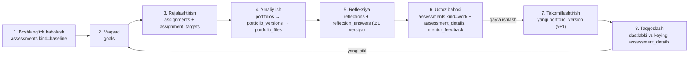
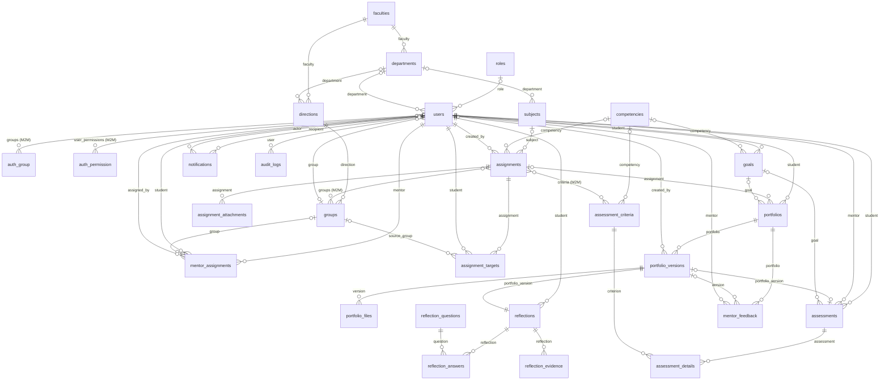

# Ma’lumotlar bazasi tuzilmasi (PostgreSQL ERD)

> Bu fayl `python manage.py generate_erd` buyrug‘i bilan modellardan avtomatik yaratiladi — qo‘lda tahrirlamang.

## Rivojlanish siklining ma’lumotlar bazasidagi bog‘liqligi

* `portfolios.goal_id` va `portfolios.assignment_id` ishni maqsad va topshiriqqa bog‘laydi;
* `portfolio_versions` hech qachon o‘chirilmaydi — har bir qayta yuklash yangi versiya;
* `reflections.portfolio_version_id` va `assessments.portfolio_version_id` — UNIQUE (har versiyaga bitta);
* `assessment_details.max_score` — mezon maksimal balining nusxasi (mezon keyin o‘zgarsa ham tarix buzilmaydi);
* `reflection_answers.question_text` — savol matnining nusxasi (savol o‘zgarsa ham javob konteksti saqlanadi).

## ER diagramma

## Jadvallar

### `roles` — Rollar (`accounts.Role`)

| Maydon | Turi | Majburiy | Bog‘lanish / izoh |
|---|---|---|---|
| `id` | bigserial | avto | ID; PK |
| `code` | varchar(20) | ha | Kod; UNIQUE; qiymatlar: `admin`, `mentor`, `student` |
| `name` | varchar(100) | ha | Nomi |
| `description` | text | yo‘q | Tavsif |

### `users` — Foydalanuvchilar (`accounts.User`)

| Maydon | Turi | Majburiy | Bog‘lanish / izoh |
|---|---|---|---|
| `id` | bigserial | avto | ID; PK |
| `password` | varchar(128) | ha | parol |
| `last_login` | timestamptz | yo‘q | oxirgi kirish |
| `is_superuser` | boolean | ha | superuser status; standart: `False` |
| `username` | varchar(150) | ha | username; UNIQUE |
| `first_name` | varchar(150) | yo‘q | first name |
| `last_name` | varchar(150) | yo‘q | last name |
| `is_staff` | boolean | ha | staff status; standart: `False` |
| `is_active` | boolean | ha | active; standart: `True` |
| `date_joined` | timestamptz | ha | date joined |
| `middle_name` | varchar(150) | yo‘q | Otasining ismi |
| `email` | varchar(254) | yo‘q | Elektron pochta |
| `phone` | varchar(20) | yo‘q | Telefon raqami |
| `avatar` | varchar (fayl yo‘li) | yo‘q | Profil rasmi |
| `role_id` | bigint FK | yo‘q | Rol; → `roles.id` (PROTECT) |
| `group_id` | bigint FK | yo‘q | Guruh; → `groups.id` (SET_NULL) |
| `department_id` | bigint FK | yo‘q | Kafedra; → `departments.id` (SET_NULL) |
| `external_id` | varchar(50) | yo‘q | Talaba / xodim ID |
| `must_change_password` | boolean | ha | Parolni o‘zgartirish talab etiladi; standart: `False` |
| `language` | varchar(5) | ha | Til; qiymatlar: `en`, `uz`; standart: `en` |
| *groups* | M2M | — | `users_groups` orqali → `auth_group` |
| *user_permissions* | M2M | — | `users_user_permissions` orqali → `auth_permission` |

Cheklovlar: UNIQUE(email) WHERE (NOT (AND: ('email', ''))) — `uniq_user_email`; UNIQUE(external_id) WHERE (NOT (AND: ('external_id', ''))) — `uniq_user_external_id`

### `mentor_assignments` — Ustoz biriktiruvlari (`accounts.MentorAssignment`)

| Maydon | Turi | Majburiy | Bog‘lanish / izoh |
|---|---|---|---|
| `id` | bigserial | avto | ID; PK |
| `mentor_id` | bigint FK | ha | Ustoz; → `users.id` (CASCADE) |
| `student_id` | bigint FK | yo‘q | Talaba; → `users.id` (CASCADE) |
| `group_id` | bigint FK | yo‘q | Guruh; → `groups.id` (CASCADE) |
| `assigned_by_id` | bigint FK | yo‘q | Biriktirgan; → `users.id` (SET_NULL) |
| `start_date` | date | ha | Boshlanish sanasi |
| `end_date` | date | yo‘q | Tugash sanasi |
| `is_active` | boolean | ha | Faol; standart: `True` |
| `note` | varchar(255) | yo‘q | Izoh |
| `created_at` | timestamptz | avto | created at |

Cheklovlar: CHECK (OR: (AND: ('group__isnull', True), ('student__isnull', False)), (AND: ('group__isnull', False), ('student__isnull', True))) — `mentor_assignment_single_target`; UNIQUE(mentor, student) WHERE (AND: ('is_active', True), ('student__isnull', False)) — `uniq_active_mentor_student`; UNIQUE(mentor, group) WHERE (AND: ('group__isnull', False), ('is_active', True)) — `uniq_active_mentor_group`

### `faculties` — Fakultetlar (`organization.Faculty`)

| Maydon | Turi | Majburiy | Bog‘lanish / izoh |
|---|---|---|---|
| `id` | bigserial | avto | ID; PK |
| `name` | varchar(255) | ha | Nomi; UNIQUE |
| `short_name` | varchar(50) | yo‘q | Qisqa nomi |
| `is_active` | boolean | ha | Faol; standart: `True` |
| `created_at` | timestamptz | avto | created at |

### `departments` — Kafedralar (`organization.Department`)

| Maydon | Turi | Majburiy | Bog‘lanish / izoh |
|---|---|---|---|
| `id` | bigserial | avto | ID; PK |
| `faculty_id` | bigint FK | ha | Fakultet; → `faculties.id` (PROTECT) |
| `name` | varchar(255) | ha | Nomi |
| `is_active` | boolean | ha | Faol; standart: `True` |
| `created_at` | timestamptz | avto | created at |

Cheklovlar: UNIQUE(faculty, name) — `uniq_department_per_faculty`

### `directions` — Ta’lim yo‘nalishlari (`organization.Direction`)

| Maydon | Turi | Majburiy | Bog‘lanish / izoh |
|---|---|---|---|
| `id` | bigserial | avto | ID; PK |
| `faculty_id` | bigint FK | ha | Fakultet; → `faculties.id` (PROTECT) |
| `department_id` | bigint FK | yo‘q | Kafedra; → `departments.id` (SET_NULL) |
| `code` | varchar(30) | ha | Shifr; UNIQUE |
| `name` | varchar(255) | ha | Nomi |
| `is_active` | boolean | ha | Faol; standart: `True` |
| `created_at` | timestamptz | avto | created at |

### `groups` — Guruhlar (`organization.StudyGroup`)

| Maydon | Turi | Majburiy | Bog‘lanish / izoh |
|---|---|---|---|
| `id` | bigserial | avto | ID; PK |
| `direction_id` | bigint FK | ha | Yo‘nalish; → `directions.id` (PROTECT) |
| `name` | varchar(50) | ha | Guruh nomi; UNIQUE |
| `course` | smallint | ha | Kurs; standart: `1` |
| `academic_year` | varchar(9) | yo‘q | O‘quv yili |
| `is_active` | boolean | ha | Faol; standart: `True` |
| `created_at` | timestamptz | avto | created at |

### `subjects` — Fanlar (`subjects.Subject`)

| Maydon | Turi | Majburiy | Bog‘lanish / izoh |
|---|---|---|---|
| `id` | bigserial | avto | ID; PK |
| `name` | varchar(255) | ha | Fan nomi |
| `code` | varchar(30) | yo‘q | Fan kodi |
| `department_id` | bigint FK | yo‘q | Kafedra; → `departments.id` (SET_NULL) |
| `description` | text | yo‘q | Tavsif |
| `is_active` | boolean | ha | Faol; standart: `True` |
| `created_at` | timestamptz | avto | created at |

Cheklovlar: UNIQUE(code) WHERE (NOT (AND: ('code', ''))) — `uniq_subject_code`

### `competencies` — Kompetensiyalar (`competencies.Competency`)

| Maydon | Turi | Majburiy | Bog‘lanish / izoh |
|---|---|---|---|
| `id` | bigserial | avto | ID; PK |
| `code` | varchar(50) | ha | Kod; UNIQUE |
| `name` | varchar(255) | ha | Nomi |
| `description` | text | yo‘q | Tavsif |
| `order` | smallint | ha | Tartib; standart: `0` |
| `is_active` | boolean | ha | Faol; standart: `True` |

### `assessment_criteria` — Baholash mezonlari (`competencies.AssessmentCriterion`)

| Maydon | Turi | Majburiy | Bog‘lanish / izoh |
|---|---|---|---|
| `id` | bigserial | avto | ID; PK |
| `competency_id` | bigint FK | yo‘q | Kompetensiya; → `competencies.id` (PROTECT) |
| `name` | varchar(255) | ha | Mezon nomi |
| `description` | text | yo‘q | Tavsif |
| `max_score` | smallint | ha | Maksimal ball; standart: `20` |
| `order` | smallint | ha | Tartib; standart: `0` |
| `is_active` | boolean | ha | Faol; standart: `True` |

### `goals` — Rivojlanish maqsadlari (`goals.Goal`)

| Maydon | Turi | Majburiy | Bog‘lanish / izoh |
|---|---|---|---|
| `id` | bigserial | avto | ID; PK |
| `student_id` | bigint FK | ha | Talaba; → `users.id` (CASCADE) |
| `title` | varchar(255) | ha | Maqsad nomi |
| `description` | text | yo‘q | Maqsad tavsifi |
| `competency_id` | bigint FK | yo‘q | Rivojlantiriladigan kompetensiya; → `competencies.id` (PROTECT) |
| `start_date` | date | ha | Boshlanish sanasi |
| `target_date` | date | ha | Rejalashtirilgan tugash sanasi |
| `expected_outcome` | text | ha | Kutilayotgan natija |
| `status` | varchar(20) | ha | Holati; qiymatlar: `new`, `in_progress`, `completed`, `cancelled`; standart: `new`; INDEX |
| `completed_at` | timestamptz | yo‘q | Bajarilgan vaqt |
| `created_at` | timestamptz | avto | created at |
| `updated_at` | timestamptz | avto | updated at |

Cheklovlar: CHECK (AND: ('target_date__gte', F(start_date))) — `goal_dates_order`

### `assignments` — Topshiriqlar (`assignments.Assignment`)

| Maydon | Turi | Majburiy | Bog‘lanish / izoh |
|---|---|---|---|
| `id` | bigserial | avto | ID; PK |
| `title` | varchar(255) | ha | Topshiriq nomi |
| `description` | text | ha | Batafsil tavsif |
| `subject_id` | bigint FK | yo‘q | Fan; → `subjects.id` (PROTECT) |
| `competency_id` | bigint FK | yo‘q | Rivojlantiriladigan kompetensiya; → `competencies.id` (PROTECT) |
| `instructions` | text | yo‘q | Bajarish bo‘yicha yo‘riqnoma |
| `criteria_notes` | text | yo‘q | Baholash mezonlari bo‘yicha izoh |
| `start_date` | timestamptz | ha | Boshlanish muddati |
| `due_date` | timestamptz | ha | Yakuniy muddat |
| `created_by_id` | bigint FK | ha | Ustoz; → `users.id` (PROTECT) |
| `is_active` | boolean | ha | Faol; standart: `True` |
| `created_at` | timestamptz | avto | created at |
| `updated_at` | timestamptz | avto | updated at |
| *criteria* | M2M | — | `assignments_criteria` orqali → `assessment_criteria` |
| *groups* | M2M | — | `assignments_groups` orqali → `groups` |

Cheklovlar: CHECK (AND: ('due_date__gt', F(start_date))) — `assignment_due_after_start`

### `assignment_attachments` — Topshiriq fayllari (`assignments.AssignmentAttachment`)

| Maydon | Turi | Majburiy | Bog‘lanish / izoh |
|---|---|---|---|
| `id` | bigserial | avto | ID; PK |
| `assignment_id` | bigint FK | ha | assignment; → `assignments.id` (CASCADE) |
| `file` | varchar (fayl yo‘li) | ha | Fayl |
| `original_name` | varchar(255) | ha | Fayl nomi |
| `file_size` | bigint | ha | Hajmi; standart: `0` |
| `mime_type` | varchar(120) | yo‘q | mime type |
| `category` | varchar(20) | yo‘q | category |
| `uploaded_at` | timestamptz | avto | uploaded at |

### `assignment_targets` — Topshiriq ijrochilari (`assignments.AssignmentTarget`)

| Maydon | Turi | Majburiy | Bog‘lanish / izoh |
|---|---|---|---|
| `id` | bigserial | avto | ID; PK |
| `assignment_id` | bigint FK | ha | Topshiriq; → `assignments.id` (CASCADE) |
| `student_id` | bigint FK | ha | Talaba; → `users.id` (CASCADE) |
| `source_group_id` | bigint FK | yo‘q | Guruh orqali; → `groups.id` (SET_NULL) |
| `status` | varchar(20) | ha | Holati; qiymatlar: `new`, `accepted`, `in_progress`, `submitted`, `revision`, `approved`, `overdue`; standart: `new`; INDEX |
| `accepted_at` | timestamptz | yo‘q | accepted at |
| `submitted_at` | timestamptz | yo‘q | submitted at |
| `completed_at` | timestamptz | yo‘q | completed at |
| `deadline_reminder_sent` | boolean | ha | deadline reminder sent; standart: `False` |
| `created_at` | timestamptz | avto | created at |
| `updated_at` | timestamptz | avto | updated at |

Cheklovlar: UNIQUE(assignment, student) — `uniq_assignment_student`

### `portfolios` — Portfolio ishlari (`portfolios.Portfolio`)

| Maydon | Turi | Majburiy | Bog‘lanish / izoh |
|---|---|---|---|
| `id` | bigserial | avto | ID; PK |
| `student_id` | bigint FK | ha | Talaba; → `users.id` (PROTECT) |
| `title` | varchar(255) | ha | Ish nomi |
| `description` | text | yo‘q | Tavsifi |
| `assignment_id` | bigint FK | yo‘q | Bog‘langan topshiriq; → `assignments.id` (PROTECT) |
| `goal_id` | bigint FK | yo‘q | Bog‘langan rivojlanish maqsadi; → `goals.id` (PROTECT) |
| `material_type` | varchar(20) | ha | Material turi; qiymatlar: `lesson_plan`, `video`, `audio`, `image`, `presentation`, `other`; standart: `lesson_plan` |
| `status` | varchar(20) | ha | Ish holati; qiymatlar: `draft`, `submitted`, `revision`, `approved`; standart: `draft`; INDEX |
| `current_version` | smallint | ha | Joriy versiya; standart: `0` |
| `submitted_at` | timestamptz | yo‘q | Yuborilgan vaqt |
| `approved_at` | timestamptz | yo‘q | Tasdiqlangan vaqt |
| `created_at` | timestamptz | avto | Yaratilgan |
| `updated_at` | timestamptz | avto | Yangilangan |

Cheklovlar: UNIQUE(student, assignment) WHERE (AND: ('assignment__isnull', False)) — `uniq_portfolio_per_assignment`

### `portfolio_versions` — Ish versiyalari (`portfolios.PortfolioVersion`)

| Maydon | Turi | Majburiy | Bog‘lanish / izoh |
|---|---|---|---|
| `id` | bigserial | avto | ID; PK |
| `portfolio_id` | bigint FK | ha | Ish; → `portfolios.id` (CASCADE) |
| `version_number` | smallint | ha | Versiya raqami |
| `note` | text | yo‘q | O‘zgarishlar izohi |
| `created_by_id` | bigint FK | yo‘q | created by; → `users.id` (SET_NULL) |
| `created_at` | timestamptz | avto | Yuklangan sana |
| `submitted_at` | timestamptz | yo‘q | Tekshirishga yuborilgan |

Cheklovlar: UNIQUE(portfolio, version_number) — `uniq_portfolio_version`

### `portfolio_files` — Ish fayllari (`portfolios.PortfolioFile`)

| Maydon | Turi | Majburiy | Bog‘lanish / izoh |
|---|---|---|---|
| `id` | bigserial | avto | ID; PK |
| `version_id` | bigint FK | ha | Versiya; → `portfolio_versions.id` (CASCADE) |
| `file` | varchar (fayl yo‘li) | ha | Fayl |
| `original_name` | varchar(255) | ha | Fayl nomi |
| `file_size` | bigint | ha | Hajmi (bayt); standart: `0` |
| `mime_type` | varchar(120) | ha | MIME turi |
| `category` | varchar(20) | ha | Toifa |
| `uploaded_at` | timestamptz | avto | Yuklangan vaqt |

### `reflection_questions` — Refleksiya savollari (`reflections.ReflectionQuestion`)

| Maydon | Turi | Majburiy | Bog‘lanish / izoh |
|---|---|---|---|
| `id` | bigserial | avto | ID; PK |
| `framework` | varchar(20) | ha | Model; qiymatlar: `gibbs`, `kolb`, `simple`; standart: `gibbs` |
| `stage` | varchar(40) | yo‘q | Bosqich |
| `text` | varchar(500) | ha | Savol matni |
| `help_text` | varchar(500) | yo‘q | Yordamchi izoh |
| `order` | smallint | ha | Tartib; standart: `0` |
| `is_required` | boolean | ha | Majburiy; standart: `True` |
| `is_active` | boolean | ha | Faol; standart: `True` |

### `reflections` — Refleksiyalar (`reflections.Reflection`)

| Maydon | Turi | Majburiy | Bog‘lanish / izoh |
|---|---|---|---|
| `id` | bigserial | avto | ID; PK |
| `student_id` | bigint FK | ha | Talaba; → `users.id` (PROTECT) |
| `portfolio_version_id` | bigint FK UNIQUE | ha | Ish versiyasi; → `portfolio_versions.id` (CASCADE); UNIQUE |
| `framework` | varchar(20) | ha | Model; qiymatlar: `gibbs`, `kolb`, `simple`; standart: `gibbs`; INDEX |
| `status` | varchar(20) | ha | Holati; qiymatlar: `draft`, `submitted`; standart: `draft`; INDEX |
| `submitted_at` | timestamptz | yo‘q | Yuborilgan vaqt |
| `created_at` | timestamptz | avto | Yaratilgan |
| `updated_at` | timestamptz | avto | Yangilangan |

### `reflection_answers` — Refleksiya javoblari (`reflections.ReflectionAnswer`)

| Maydon | Turi | Majburiy | Bog‘lanish / izoh |
|---|---|---|---|
| `id` | bigserial | avto | ID; PK |
| `reflection_id` | bigint FK | ha | reflection; → `reflections.id` (CASCADE) |
| `question_id` | bigint FK | ha | question; → `reflection_questions.id` (PROTECT) |
| `question_text` | varchar(500) | ha | Savol (nusxa) |
| `stage` | varchar(40) | yo‘q | Bosqich (nusxa) |
| `answer` | text | yo‘q | Javob |
| `updated_at` | timestamptz | avto | updated at |

Cheklovlar: UNIQUE(reflection, question) — `uniq_reflection_answer`

### `reflection_evidence` — Refleksiya dalillari (`reflections.ReflectionEvidence`)

| Maydon | Turi | Majburiy | Bog‘lanish / izoh |
|---|---|---|---|
| `id` | bigserial | avto | ID; PK |
| `reflection_id` | bigint FK | ha | reflection; → `reflections.id` (CASCADE) |
| `file` | varchar (fayl yo‘li) | yo‘q | Fayl |
| `original_name` | varchar(255) | yo‘q | original name |
| `file_size` | bigint | ha | file size; standart: `0` |
| `mime_type` | varchar(120) | yo‘q | mime type |
| `category` | varchar(20) | yo‘q | category |
| `link` | varchar(200) | yo‘q | Havola |
| `description` | varchar(255) | yo‘q | Izoh |
| `created_at` | timestamptz | avto | created at |

### `assessments` — Baholash natijalari (`assessments.Assessment`)

| Maydon | Turi | Majburiy | Bog‘lanish / izoh |
|---|---|---|---|
| `id` | bigserial | avto | ID; PK |
| `kind` | varchar(20) | ha | Baholash turi; qiymatlar: `baseline`, `work`; standart: `work` |
| `student_id` | bigint FK | ha | Talaba; → `users.id` (PROTECT) |
| `mentor_id` | bigint FK | ha | Ustoz; → `users.id` (PROTECT) |
| `portfolio_version_id` | bigint FK UNIQUE | yo‘q | Ish versiyasi; → `portfolio_versions.id` (PROTECT); UNIQUE |
| `goal_id` | bigint FK | yo‘q | Rivojlanish maqsadi; → `goals.id` (SET_NULL) |
| `decision` | varchar(20) | yo‘q | Qaror; qiymatlar: `approved`, `revision` |
| `total_score` | smallint | ha | Jami ball; standart: `0` |
| `max_score` | smallint | ha | Maksimal ball; standart: `0` |
| `overall_comment` | text | yo‘q | Umumiy xulosa |
| `created_at` | timestamptz | avto | Baholangan vaqt; INDEX |
| `updated_at` | timestamptz | avto | updated at |

Cheklovlar: CHECK (OR: (AND: ('kind', 'work'), ('portfolio_version__isnull', False)), (AND: ('kind', 'baseline'), ('portfolio_version__isnull', True))) — `assessment_kind_matches_version`

### `assessment_details` — Mezonlar bo‘yicha baholar (`assessments.AssessmentDetail`)

| Maydon | Turi | Majburiy | Bog‘lanish / izoh |
|---|---|---|---|
| `id` | bigserial | avto | ID; PK |
| `assessment_id` | bigint FK | ha | assessment; → `assessments.id` (CASCADE) |
| `criterion_id` | bigint FK | ha | Mezon; → `assessment_criteria.id` (PROTECT) |
| `score` | smallint | ha | Ball |
| `max_score` | smallint | ha | Maksimal ball (nusxa) |
| `comment` | text | yo‘q | Izoh |
| `weaknesses` | text | yo‘q | Kamchiliklar |
| `recommendations` | text | yo‘q | Takomillashtirish bo‘yicha tavsiya |

Cheklovlar: UNIQUE(assessment, criterion) — `uniq_assessment_criterion`; CHECK (AND: ('score__lte', F(max_score))) — `detail_score_lte_max`

### `mentor_feedback` — Ustoz fikrlari (`assessments.MentorFeedback`)

| Maydon | Turi | Majburiy | Bog‘lanish / izoh |
|---|---|---|---|
| `id` | bigserial | avto | ID; PK |
| `portfolio_id` | bigint FK | ha | Ish; → `portfolios.id` (CASCADE) |
| `version_id` | bigint FK | yo‘q | Versiya; → `portfolio_versions.id` (SET_NULL) |
| `mentor_id` | bigint FK | ha | Ustoz; → `users.id` (PROTECT) |
| `kind` | varchar(20) | ha | Turi; qiymatlar: `comment`, `recommendation`; standart: `comment` |
| `text` | text | ha | Matn |
| `created_at` | timestamptz | avto | created at |

### `notifications` — Bildirishnomalar (`notifications.Notification`)

| Maydon | Turi | Majburiy | Bog‘lanish / izoh |
|---|---|---|---|
| `id` | bigserial | avto | ID; PK |
| `recipient_id` | bigint FK | ha | Qabul qiluvchi; → `users.id` (CASCADE) |
| `actor_id` | bigint FK | yo‘q | Yuboruvchi; → `users.id` (SET_NULL) |
| `type` | varchar(30) | ha | Turi; qiymatlar: `assignment_new`, `deadline_soon`, `work_submitted`, `feedback`, `revision`, `approved`, `system`; standart: `system` |
| `title` | varchar(255) | ha | Sarlavha |
| `message` | text | yo‘q | Matn |
| `url` | varchar(500) | yo‘q | Havola |
| `is_read` | boolean | ha | O‘qilgan; standart: `False` |
| `read_at` | timestamptz | yo‘q | read at |
| `emailed` | boolean | ha | emailed; standart: `False` |
| `created_at` | timestamptz | avto | created at; INDEX |

### `audit_logs` — Audit log (`audit.AuditLog`)

| Maydon | Turi | Majburiy | Bog‘lanish / izoh |
|---|---|---|---|
| `id` | bigserial | avto | ID; PK |
| `user_id` | bigint FK | yo‘q | Foydalanuvchi; → `users.id` (SET_NULL) |
| `action` | varchar(20) | ha | Amal; qiymatlar: `login`, `logout`, `login_failed`, `create`, `update`, `delete`, `block`, `unblock`, `import`, `upload`, `submit`, `assess`, `password`, `assign`, `download`; INDEX |
| `object_type` | varchar(100) | yo‘q | Obyekt turi |
| `object_id` | varchar(64) | yo‘q | Obyekt ID |
| `object_repr` | varchar(255) | yo‘q | Obyekt |
| `message` | text | yo‘q | Izoh |
| `extra` | jsonb | yo‘q | Qo‘shimcha ma’lumot |
| `ip_address` | inet | yo‘q | IP manzil |
| `user_agent` | varchar(255) | yo‘q | Brauzer |
| `created_at` | timestamptz | avto | Vaqt; INDEX |

### `system_settings` — Tizim sozlamalari (`core.SystemSettings`)

| Maydon | Turi | Majburiy | Bog‘lanish / izoh |
|---|---|---|---|
| `id` | bigserial | avto | ID; PK |
| `platform_name` | varchar(150) | ha | Platforma nomi; standart: `Refleksiv portfolio` |
| `organization_name` | varchar(255) | yo‘q | Ta’lim muassasasi |
| `max_upload_size_mb` | integer | ha | Hujjat/rasm/audio fayl hajmi limiti (MB); standart: `50` |
| `max_video_size_mb` | integer | ha | Video fayl hajmi limiti (MB); standart: `1024` |
| `allowed_video_extensions` | varchar(100) | ha | Ruxsat etilgan video formatlari; standart: `mp4,webm,mov` |
| `deadline_reminder_hours` | integer | ha | Muddat eslatmasi (soat oldin); standart: `24` |
| `allow_late_submission` | boolean | ha | Muddatdan keyin topshirishga ruxsat; standart: `True` |
| `updated_at` | timestamptz | avto | updated at |
